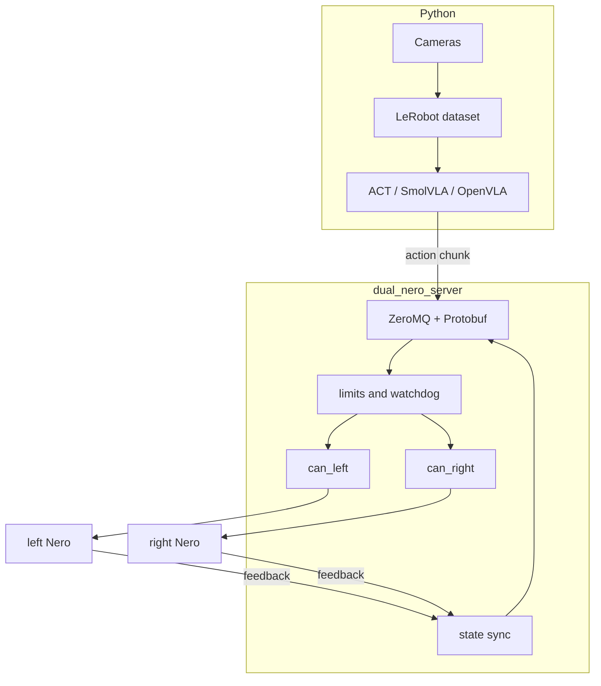
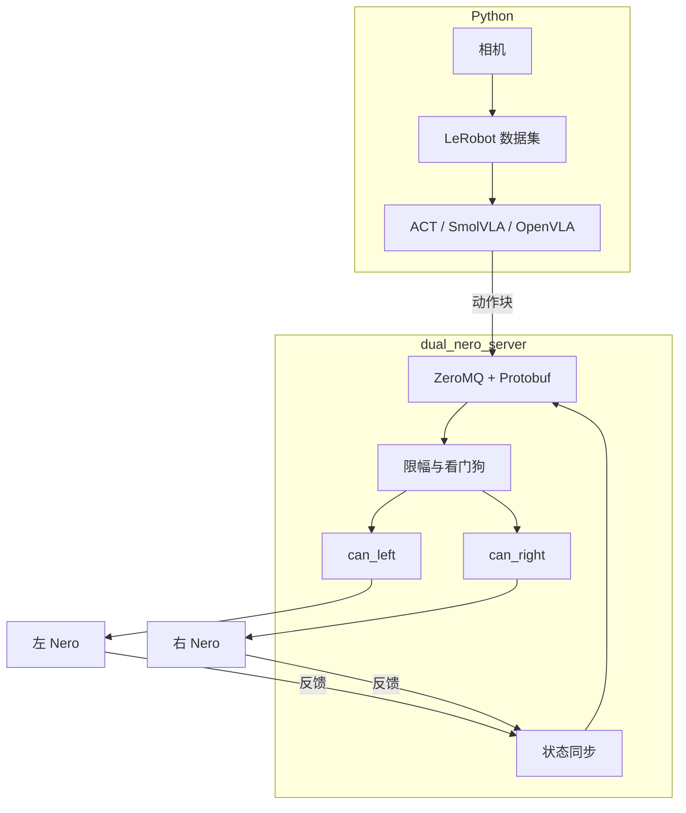

# Dual Nero VLA

[English docs](docs/README.md) | [中文文档](docs_cn/README_cn.md)

Dual Nero VLA is a design for two AgileX Nero 7-DoF arms and two AGX two-finger grippers. A future C++ service owns Linux SocketCAN, arm state, and safety, and it is the only process allowed to send CAN command frames. Python owns cameras, datasets, LeRobot, and VLA inference, and it requests motion over IPC.

**Target design — not implemented.** This repository does not yet contain that service. `AgileX/` keeps the vendor models and the Nero protocol reference. Implementation follows the [roadmap](docs/maintenance/roadmap.md).

## Read next

- [Architecture](docs/design/architecture.md) explains ownership and data flow.
- [Setup](docs/usage/setup.md) covers the operator path from the host to a read-only CAN check.
- [IPC contract](docs/interfaces/ipc.md) is the Python-to-C++ boundary.
- [Modules](docs/develop/modules.md) names the C++ owners and the code rules.
- [Logging](docs/debug/logging.md) and the [roadmap](docs/maintenance/roadmap.md) record failure evidence and the delivery order.

## 中文

Dual Nero VLA 面向两台 AgileX Nero 七自由度机械臂和两只 AGX 两指夹爪。计划中的 C++ 服务拥有 Linux SocketCAN、机械臂状态和安全保护，并且是唯一可以发送 CAN 控制帧的进程。Python 负责相机、数据集、LeRobot 和 VLA 推理，通过 IPC 请求运动。

**目标设计，尚未实现。** 这个仓库里还没有该服务。`AgileX/` 保留厂商模型和 Nero 协议参考。实现顺序见[路线图](docs_cn/maintenance/roadmap_cn.md)。

## 接着读

- [架构](docs_cn/design/architecture_cn.md) 说明所有权和数据流。
- [环境与接通](docs_cn/usage/setup_cn.md) 从主机环境走到只读 CAN 检查。
- [IPC 契约](docs_cn/interfaces/ipc_cn.md) 是 Python 与 C++ 的边界。
- [模块](docs_cn/develop/modules_cn.md) 列出 C++ 责任划分和代码规则。
- [日志](docs_cn/debug/logging_cn.md) 与[路线图](docs_cn/maintenance/roadmap_cn.md) 记录故障证据和交付顺序。
