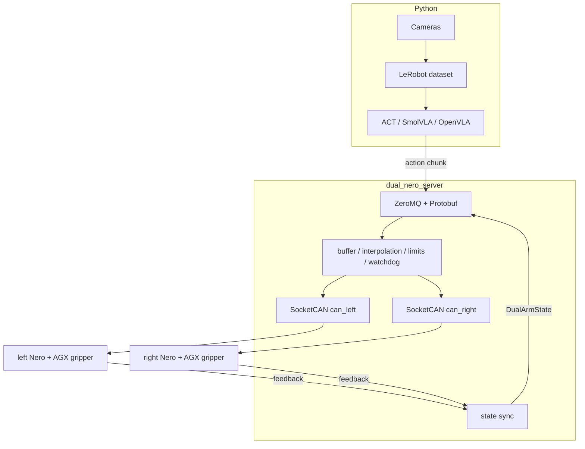

# Architecture

[中文](../../docs_cn/design/architecture_cn.md) | [Documentation index](../README.md)

**Target design — not implemented.** The service, IPC socket, and safety supervisor described here are not in the tree. The delivery checklist is the [roadmap](../maintenance/roadmap.md).

Dual Nero VLA controls two AgileX Nero 7-DoF arms and two AGX two-finger grippers without ROS. The C++ process `dual_nero_server` is the only sender of CAN command frames. Python collects cameras, stores LeRobot datasets, and runs ACT, SmolVLA, or OpenVLA. It submits action requests over IPC and never opens SocketCAN.

## Ownership

`dual_nero_server` owns admission of motion requests, the arm state machines, SocketCAN transport, firmware-specific encoding, interpolation, limits, the watchdog, and emergency stop. Python owns image capture, dataset layout, training, and inference. `AgileX/` owns nothing at runtime. It is the checked-in vendor reference for URDF, the official Python SDK, and the Nero CAN behavior that `NeroProtocol` must match before any command encoder is written.

LeRobot, ACT, SmolVLA, and OpenVLA stay in Python because their training stack is PyTorch. A stall in inference must not block CAN receive. Replacing a model must not change the arm driver. A Python exception must not bypass the C++ limits. Inference may later run on another GPU machine. A mature policy may later be exported to ONNX or TensorRT, which does not move safety out of the C++ process.

## Data flow

A feedback frame enters through `CanTransport`, which does not interpret Nero fields. `NeroProtocol` decodes it into SI units and updates one arm state. `StateSynchronizer` pairs the latest left and right samples. The IPC publisher sends that pair to Python. An action chunk travels the other way: IPC admission checks shape, finiteness, sequence, and expiry; the safety supervisor checks joints, speed, and workspace; only then does `NeroProtocol` encode a position command for the selected firmware profile.

## Threads

The target split is one receive thread per CAN bus, one thread for command send and interpolation, one thread for state sync and IPC publish, one safety and watchdog thread, and one IPC request thread. A receive thread does not call a model, write the disk, or allocate a large buffer on the hot path. A dropped IPC client does not exit a CAN thread. Command queues are bounded and keep the newest valid chunk rather than growing without limit.

## Decisions

C++ talks to the arms through SocketCAN and does not require a ROS graph. Python uses the [IPC contract](../interfaces/ipc.md) and does not send CAN frames. Protocol differences are explicit firmware profiles, and an unknown profile refuses motion instead of silently reusing another profile. Limits, the watchdog, and emergency stop live in the C++ process. LeRobot records the measured state, the requested action, and the action actually accepted after limiting. Read-only comparison against `pyAgxArm` comes before enable and motion. The first motion stage is position control. MIT torque control and unverified high-speed CPV stay closed until the mechanical and electrical checks exist.

## Still required before encoding

`NeroProtocol` is not written until these inputs are known: the firmware version on each Nero, the teach-pendant model and its bus, the position command the first version will use, the camera models and rates, and whether inference shares the CAN host. After that, the encoder and its golden-frame tests come from the official profile, not from the Piper protocol.
