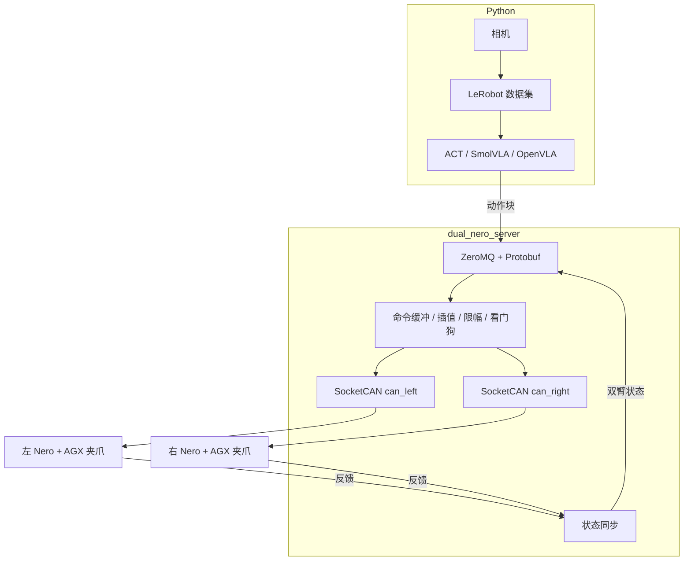

# 架构

[English](../../docs/design/architecture.md) | [文档入口](../README_cn.md)

**目标设计，尚未实现。** 这里描述的服务、IPC 套接字和安全监控器还不在仓库里。交付清单是[路线图](../maintenance/roadmap_cn.md)。

Dual Nero VLA 在不使用 ROS 的情况下控制两台 AgileX Nero 七自由度机械臂和两只 AGX 两指夹爪。C++ 进程 `dual_nero_server` 是唯一发送 CAN 控制帧的进程。Python 采集相机、保存 LeRobot 数据集，并运行 ACT、SmolVLA 或 OpenVLA。它通过 IPC 提交动作请求，不打开 SocketCAN。

## 所有权

`dual_nero_server` 负责动作请求的准入、机械臂状态机、SocketCAN 传输、按固件编码、插值、限幅、看门狗和急停。Python 负责图像采集、数据集、训练和推理。`AgileX/` 在运行时不拥有任何设备。它是入库的厂商参考，用来核对 URDF、官方 Python SDK，以及编写 `NeroProtocol` 之前必须对齐的 Nero CAN 行为。

LeRobot、ACT、SmolVLA 和 OpenVLA 留在 Python，因为它们的训练栈是 PyTorch。推理卡顿不得阻塞 CAN 接收。更换模型不得修改机械臂驱动。Python 异常不得绕过 C++ 限幅。推理以后可以放在另一台 GPU 机器上。成熟策略以后可以导出到 ONNX 或 TensorRT，安全逻辑仍然留在 C++ 进程里。

## 数据流

反馈帧从 `CanTransport` 进入，这一层不解释 Nero 字段。`NeroProtocol` 把它解码成国际单位制并更新一条机械臂状态。`StateSynchronizer` 配对最新的左右样本。IPC 发布把这一对状态送给 Python。动作块走相反方向：IPC 准入检查形状、有限值、序号和有效期；安全监控器检查关节、速度和工作空间；然后 `NeroProtocol` 才按所选固件档位编码位置命令。

## 线程

目标划分是每条 CAN 总线一个接收线程，一个命令发送与插值线程，一个状态同步与 IPC 发布线程，一个安全与看门狗线程，以及一个 IPC 请求线程。接收线程不调用模型、不写磁盘，也不在热路径上做大块分配。IPC 客户端断开不会让 CAN 线程退出。命令队列有界，保留最新的有效动作块，而不是无限堆积。

## 设计结论

C++ 通过 SocketCAN 与机械臂通信，不依赖 ROS 图。Python 使用 [IPC 契约](../interfaces/ipc_cn.md)，不发送 CAN 帧。协议差异写成显式固件档位，未知档位拒绝运动，而不是静默复用另一档位。限幅、看门狗和急停位于 C++ 进程。LeRobot 同时记录实测状态、请求动作和限幅后实际接受的动作。使能和运动之前，先与 `pyAgxArm` 做只读对比。第一阶段运动只做位置控制。MIT 力矩控制和未经验证的高速 CPV 保持关闭，直到机械和电气检查存在。

## 编码之前仍需确认

在这些输入明确之前不编写 `NeroProtocol`：每台 Nero 的固件版本、示教器型号和它所在的总线、第一版要使用的位置命令、相机型号和帧率，以及推理是否与 CAN 主机在同一台机器。之后，编码器和黄金报文测试来自官方档位，不来自 Piper 协议。
